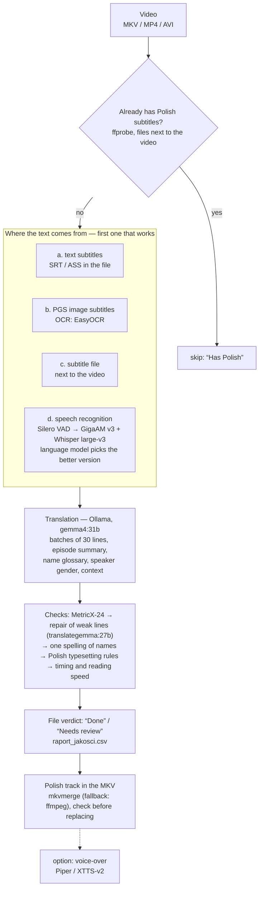

# MKV Translator

Translates movie and series subtitles (Russian, English, Ukrainian) into **Polish or English** with local AI models through [Ollama](https://ollama.com). The result goes into the MKV file as a new subtitle track, or into a `.pl.srt` / `.en.srt` file next to the video. When a file has no subtitles, the program recognises the speech and translates that.

**Wersja polska: [README.md](README.md)**

The program window and messages are available in Polish and English (language switch in the top-right corner). Everything runs on your own computer; nothing is sent to the internet.

## Features

- **Subtitle sources:** text tracks in MKV/MP4 (SRT, ASS), teletext in TS files, PGS image subtitles (OCR with EasyOCR), separate subtitle files next to the video.
- **No subtitles:** speech recognition from the audio — GigaAM v3 and Whisper large-v3 together for Russian, Whisper for other languages, optionally with voice separation (Demucs, BS-RoFormer) and speaker detection (pyannote).
- **Quality:** reference-free scoring of every line (MetricX-24), automatic repair of weak lines with a second model, a check of every file (leftover source language, loops, length, reading speed), `raport_jakosci.csv` report, a name glossary shared by the whole series.
- **Voice-over (optional):** a Polish voice track from Piper or XTTS-v2 laid over the ducked original.
- **Queue window:** resume of interrupted files, estimated finish time, notifications (Windows, phone via ntfy), subtitle track choice per file, Ollama model download, Ollama parallelism setting.
- **Server:** continuous mode (`--watch`) and a ready container for Unraid — the program runs on the server, Ollama on the PC with the graphics card.

## How it works



1. **File check.** The program reads the list of tracks. A video that already has Polish subtitles inside or next to it is skipped. “Forced” tracks (signs only) are not translated.
2. **Text source.** First text subtitles in the file, then image subtitles (PGS, read like a scan), then a subtitle file next to the video. When there is nothing, or suspiciously few subtitles, speech recognition runs.
3. **Speech recognition.** The program picks the audio track (the centre dialogue channel from 5.1) and detects the language from 8 samples spread over the whole video, so Russian speech on a track tagged “eng” does not fool it. Silero VAD finds the speech and cuts at pauses. Russian is recognised by GigaAM v3 and Whisper large-v3 at the same time, and a language model picks the better version for every minute. A filter removes Whisper “ghosts” (“Субтитры сделал…”, repeats). The text is split into lines by subtitle norms: end of sentence or pause, 42 characters × 2 lines, at most 7 s. Result: `Film.rozpoznane.ru.srt`, with a recognition confidence for every line.
4. **Translation.** Local `gemma4:31b` gets the lines in batches of 30 (two batches at once) together with an episode summary, name spellings from `slowniczek.json`, speaker gender (Polish verbs change with gender) and neighbouring lines. A sentence split across lines is translated as a whole and split back. Progress is saved in `Film.pl.part.json`, so an interrupted translation resumes where it stopped.
5. **Checks and repair.** MetricX-24 scores every line without a reference (0 = perfect, 25 = bad). Lines scoring 8 or more, and lines left in the source language, are fixed by a second model. Then: one spelling of names across the series, Polish typesetting rules (“…”, „quotes”, dialogue dashes, times written 14.30), display times and reading speed (up to 17 characters per second; lines that are too fast get shortened).
6. **File verdict.** “Done” or “Needs review”, and a row in `raport_jakosci.csv`.
7. **Writing.** mkvmerge adds the Polish track as the default one; chapters, fonts and track flags stay. Before the new file replaces the original, the program checks its length, tracks, chapters, attachments and flags. Optionally a copy of the original is kept for a few days.
8. **Voice-over (option).** Piper or XTTS-v2 reads the Polish text; the original goes quieter while the voice speaks.

### Which speech recognition is best

Measured on 6 Russian episodes with reference subtitles; share of wrongly recognised words (WER), lower is better.

| Recognition | WER |
|---|---|
| **GigaAM v3 + Whisper large-v3** (default) | **10.8%** |
| GigaAM v3 RNNT | 11.9% |
| Whisper large-v3, batched | 12.1% |
| Whisper large-v3 | 12.6% |
| GigaAM v3 + Demucs | 13.1% |
| Parakeet, Silero VAD v6, BS-RoFormer | no gain |

Translation: in a MetricX test on 360 lines `gemma4:31b` scored 4.81 and MiLMMT-46-12B 4.58 (better), but without context, glossary and summary — the default model stays unchanged. Reports: [`reports/`](reports) folder (in Polish).

### Models and tools

| Name | Used for | Runs on |
|---|---|---|
| `gemma4:31b` | main translator; also the episode summary and choosing the better speech version | Ollama |
| `translategemma:27b` | repairing weak lines (can be changed in the settings) | Ollama |
| GigaAM v3 e2e-RNNT | Russian speech recognition, with punctuation | graphics card |
| Whisper large-v3 (faster-whisper) | speech recognition in any language | graphics card |
| Silero VAD | finding speech, cutting at pauses | graphics card |
| Demucs / BS-RoFormer | optional separation of voice from music | graphics card |
| Qwen3-ForcedAligner | exact word timings | graphics card |
| pyannote community-1 | option: who speaks (dialogue dashes, gender) | graphics card |
| MetricX-24 XL | reference-free translation quality score | graphics card |
| EasyOCR | reading PGS image subtitles | graphics card |
| Piper / XTTS-v2 | optional voice-over | graphics card |
| ffmpeg / ffprobe | reading tracks, audio, voice-over mix | tool |
| mkvmerge (MKVToolNix) | building the finished MKV | tool |

Program layout: `gui.py` (window), `translate_mkv.py` (file pipeline, translation, checks, writing) and `audio_tools.py` (everything on the graphics card, in the `audio_env` environment; it runs in the background for the whole queue and frees the card for Ollama before translation). Developer details (Polish): [docs/ARCHITEKTURA.md](docs/ARCHITEKTURA.md).

## Requirements

- Windows, Python 3.12+ (the main program uses only the standard library)
- [ffmpeg](https://ffmpeg.org) in `PATH`
- optional [MKVToolNix](https://mkvtoolnix.download) — when installed, mkvmerge builds the MKV file (keeps chapters, attachments and track flags more faithfully)
- [Ollama](https://ollama.com) with a translation model — default `gemma4:31b` (it beat `translategemma:27b` in a test on two series); large models work best with a 24–32 GB graphics card
- Audio features (speech recognition, OCR, voice-over): an NVIDIA card and [uv](https://docs.astral.sh/uv/) — `install_audio.bat` creates the `audio_env` environment with pinned package versions from `requirements-audio.lock` (about 8 GB; models, about 20 GB more, download on first use)

## Running

Queue window:

```bat
python translate_mkv.py
```

or the ready `MKV-Translator.exe` from [Releases](../../releases) — put `audio_tools.py` and `ui_en.py` next to it for audio features and English messages from the audio tools.

Command line (examples):

```bat
python translate_mkv.py --mux -r "D:\Series\Show"
python translate_mkv.py --target en --ui-lang en film.mkv
python translate_mkv.py --whisper --asr whisper --whisper-model large-v3-turbo film.mkv
python translate_mkv.py --check
```

All options: `python translate_mkv.py --help`. Tests: `python -m pytest tests`.

## Speaker detection (optional)

The “detect speakers” option (`--diarize`) uses `pyannote/speaker-diarization-community-1`, which requires accepting its terms on Hugging Face. Create an account, accept the terms on the model page, create a read token and save it as the user environment variable `HF_TOKEN`. Without the token the program skips this step.

## Unraid

`unraid/` folder: `python tools/make_unraid.py` copies the current program into it. Copy the folder to the server, set the Ollama address and folders in `ustawienia.sh`, then in the Unraid terminal:

```bash
bash /mnt/user/system/mkv-translator/zainstaluj.sh
```

Every `CO_ILE_MINUT` minutes the container checks the folders and translates new files; progress: `docker logs -f mkv-translator`. The server version has no graphics card, so it translates text subtitles only (no speech recognition).

## Licence

Program code: [MIT](LICENSE) — you may use, change and distribute it, also commercially, keeping the author notice.

### Model licences

XTTS-v2 is under the Coqui CPML licence (non-commercial use only). Other models have their own licences — check them before use.
