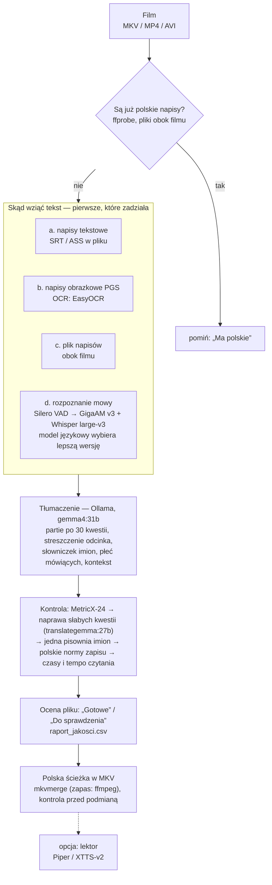

# MKV Translator

Tłumaczy napisy filmów i seriali (rosyjskie, angielskie, ukraińskie) na **polski albo angielski** lokalnymi modelami AI przez [Ollamę](https://ollama.com). Wynik trafia do pliku MKV jako nowa ścieżka napisów albo do pliku `.pl.srt` / `.en.srt` obok filmu.

**English version: [README.en.md](README.en.md)**

## Co potrafi

- **Źródła napisów:** ścieżki tekstowe w MKV/MP4 (SRT, ASS), telegazeta w plikach TS, napisy graficzne PGS (OCR, EasyOCR), osobne pliki napisów obok filmu.
- **Brak napisów:** rozpoznawanie mowy z dźwięku — dla rosyjskiego GigaAM v3 i Whisper large-v3 naraz, dla innych języków Whisper, opcjonalnie z oddzieleniem głosu od muzyki (Demucs, BS-RoFormer) i rozpoznawaniem mówców (pyannote).
- **Jakość:** kontrola każdego pliku (resztki języka źródłowego, zapętlenia, długość, tempo czytania), automatyczna naprawa podejrzanych kwestii drugim modelem, raport `raport_jakosci.csv`, słowniczek imion wspólny dla całego serialu.
- **Lektor (opcjonalnie):** polska ścieżka lektora z Piper albo XTTS-v2 nałożona na przyciszony oryginał.
- **Kolejka w oknie:** wznawianie przerwanych plików, szacowany czas końca, powiadomienia (Windows, telefon przez ntfy), wybór ścieżki napisów dla pliku, pobieranie modeli Ollamy, zmiana równoległości Ollamy.
- **Serwer:** tryb pracy ciągłej (`--watch`) i gotowy kontener dla Unraid — program na serwerze, Ollama na komputerze z kartą graficzną.

## Jak to działa



1. **Sprawdzenie pliku.** Program czyta listę ścieżek. Film z polskimi napisami w środku albo obok jest pomijany. Ścieżek „wymuszonych” (tylko napisy na tablicach) nie tłumaczy.
2. **Źródło tekstu.** Najpierw napisy tekstowe w pliku, potem obrazkowe (PGS, odczyt jak ze skanu), potem plik napisów obok filmu. Gdy nic nie ma albo napisów jest podejrzanie mało — rozpoznanie mowy.
3. **Rozpoznanie mowy.** Wybór ścieżki dźwiękowej (z 5.1 kanał centralny z dialogami) i języka z 8 próbek z całego filmu, więc rosyjska mowa na ścieżce oznaczonej „eng” nie myli programu. Silero VAD znajduje mowę i tnie w przerwach. Rosyjski rozpoznają naraz GigaAM v3 i Whisper large-v3, a model językowy dla każdej minuty wybiera lepszą wersję. Filtr usuwa „widma” Whispera („Субтитры сделал…”, powtórki). Tekst dzieli się na kwestie wg norm: koniec zdania lub pauza, 42 znaki × 2 linie, maks. 7 s. Wynik: `Film.rozpoznane.ru.srt`, każda kwestia ma pewność rozpoznania.
4. **Tłumaczenie.** Lokalny `gemma4:31b` dostaje kwestie partiami po 30 (dwie partie naraz) razem ze streszczeniem odcinka, pisownią imion ze `slowniczek.json`, płcią mówiących (zrobiłem/zrobiłam) i sąsiednimi kwestiami. Zdanie rozcięte między kwestie tłumaczy w całości i dzieli z powrotem. Postęp zapisuje się w `Film.pl.part.json` — przerwane tłumaczenie wznawia się od miejsca przerwania.
5. **Kontrola i naprawa.** MetricX-24 ocenia każdą kwestię bez wzorca (0 = idealnie, 25 = źle). Kwestie z wynikiem ≥ 8 i te, które zostały w języku źródłowym, poprawia drugi model. Dalej: jedna pisownia imion w całym serialu, polskie normy zapisu („…”, cudzysłowy, myślniki, godziny 14.30), czasy wyświetlania i tempo czytania (do 17 znaków na sekundę; zbyt szybkie kwestie są skracane).
6. **Ocena pliku.** Stan „Gotowe” albo „Do sprawdzenia” i wiersz w `raport_jakosci.csv`.
7. **Zapis.** mkvmerge dokłada polską ścieżkę jako domyślną; rozdziały, czcionki i flagi ścieżek zostają. Zanim nowy plik zastąpi oryginał, program sprawdza długość, ścieżki, rozdziały, załączniki i flagi. Opcjonalnie zostaje kopia oryginału na kilka dni.
8. **Lektor (opcja).** Piper albo XTTS-v2 czyta polski tekst; oryginał cichnie, gdy lektor mówi.

### Które rozpoznawanie mowy jest najlepsze

Pomiar na 6 rosyjskich odcinkach z wzorcowymi napisami; odsetek błędnie rozpoznanych słów (WER), mniej = lepiej.

| Rozpoznawanie | WER |
|---|---|
| **GigaAM v3 + Whisper large-v3** (domyślne) | **10,8%** |
| GigaAM v3 RNNT | 11,9% |
| Whisper large-v3 w partiach | 12,1% |
| Whisper large-v3 | 12,6% |
| GigaAM v3 + Demucs | 13,1% |
| Parakeet, Silero VAD v6, BS-RoFormer | bez poprawy |

Tłumaczenie: w ocenie MetricX na 360 kwestiach `gemma4:31b` dostała 4,81, a MiLMMT-46-12B 4,58 (lepiej), ale bez kontekstu, słowniczka i streszczenia — domyślny model pozostał bez zmian. Raporty: folder [`reports/`](reports).

### Modele i narzędzia

| Nazwa | Do czego | Gdzie działa |
|---|---|---|
| `gemma4:31b` | główny tłumacz; też streszczenie odcinka i wybór lepszej wersji mowy | Ollama |
| `translategemma:27b` | poprawianie słabych kwestii (do zmiany w ustawieniach) | Ollama |
| GigaAM v3 e2e-RNNT | rozpoznawanie rosyjskiej mowy, z interpunkcją | karta graficzna |
| Whisper large-v3 (faster-whisper) | rozpoznawanie mowy w każdym języku | karta graficzna |
| Silero VAD | wykrywanie mowy, cięcie w przerwach | karta graficzna |
| Demucs / BS-RoFormer | opcjonalne oddzielenie głosu od muzyki | karta graficzna |
| Qwen3-ForcedAligner | dokładne czasy słów | karta graficzna |
| pyannote community-1 | opcja: kto mówi (myślniki dialogowe, płeć) | karta graficzna |
| MetricX-24 XL | ocena jakości tłumaczenia bez wzorca | karta graficzna |
| EasyOCR | odczyt napisów obrazkowych PGS | karta graficzna |
| Piper / XTTS-v2 | opcjonalny lektor | karta graficzna |
| ffmpeg / ffprobe | odczyt ścieżek, dźwięk, miks lektora | narzędzie |
| mkvmerge (MKVToolNix) | składanie gotowego MKV | narzędzie |

Budowa programu: `gui.py` (okno), `translate_mkv.py` (przebieg pliku, tłumaczenie, kontrola, zapis) i `audio_tools.py` (wszystko na karcie graficznej, w środowisku `audio_env`; działa w tle przez całą kolejkę i przed tłumaczeniem zwalnia kartę dla Ollamy). Szczegóły dla programistów: [docs/ARCHITEKTURA.md](docs/ARCHITEKTURA.md).

## Wymagania

- Windows, Python 3.12+ (program główny używa tylko biblioteki standardowej)
- [ffmpeg](https://ffmpeg.org) w `PATH`
- opcjonalnie [MKVToolNix](https://mkvtoolnix.download) — gdy jest zainstalowany, plik MKV składa mkvmerge (wierniej zachowuje rozdziały, załączniki i flagi ścieżek)
- [Ollama](https://ollama.com) z modelem tłumaczącym — domyślny `gemma4:31b` (w teście na dwóch serialach wypadł lepiej niż `translategemma:27b`); dużym modelom najlepiej służy karta z 24–32 GB pamięci
- Funkcje audio (rozpoznawanie mowy, OCR, lektor): karta NVIDIA i [uv](https://docs.astral.sh/uv/) — `install_audio.bat` tworzy środowisko `audio_env` z przypiętymi wersjami pakietów z `requirements-audio.lock` (ok. 8 GB, modele — kolejne ok. 20 GB — dociągają się przy pierwszym użyciu)

## Uruchomienie

Okno kolejki:

```bat
python translate_mkv.py
```

albo gotowy `MKV Translator.exe` z zakładki [Releases](../../releases) — obok niego połóż `audio_tools.py` i `ui_en.py`, jeśli chcesz funkcji audio i angielskiego interfejsu w komunikatach narzędzi audio.

Wiersz poleceń (przykłady):

```bat
python translate_mkv.py --mux -r "D:\Seriale\Serial"
python translate_mkv.py --target en --ui-lang en film.mkv
python translate_mkv.py --whisper --asr whisper --whisper-model large-v3-turbo film.mkv
python translate_mkv.py --check
```

Pełna lista opcji: `python translate_mkv.py --help`.

## Rozpoznawanie mówców (opcjonalne)

Opcja „rozpoznawaj mówców” (`--diarize`) używa modelu `pyannote/speaker-diarization-community-1`, który na Hugging Face wymaga zaakceptowania warunków. Załóż konto, zaakceptuj warunki na stronie modelu, utwórz token z prawem odczytu i zapisz go jako zmienną środowiskową użytkownika `HF_TOKEN`. Bez tokenu program pomija ten krok.

## Unraid

Folder `unraid/`: skopiuj go na serwer razem z `translate_mkv.py` i `ui_en.py`, ustaw adres Ollamy i foldery w `ustawienia.sh`, potem w terminalu Unraid:

```bash
bash /mnt/user/system/mkv-translator/zainstaluj.sh
```

Kontener co `CO_ILE_MINUT` sprawdza foldery i tłumaczy nowe pliki; postęp: `docker logs -f mkv-translator`.

## Licencja

Kod programu: [MIT](LICENSE) — wolno go używać, zmieniać i rozpowszechniać, także komercyjnie, z zachowaniem informacji o autorze.

### Licencje modeli

XTTS-v2 jest na licencji Coqui CPML (wyłącznie użytek niekomercyjny). Pozostałe modele mają własne licencje — sprawdź je przed użyciem.
